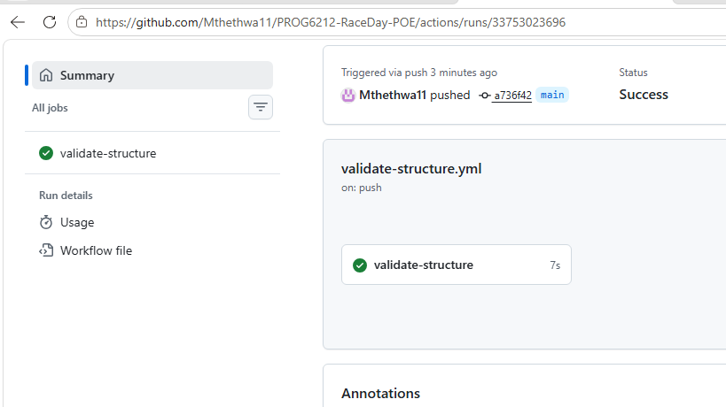

# RaceDay — Event Management System

[](https://github.com/Mthethwa11/PROG6212-RaceDay-POE/actions/workflows/validate-structure.yml)
[](https://github.com/Mthethwa11/PROG6212-RaceDay-POE/actions/workflows/build-and-test.yml)

**PROG6212 Portfolio of Evidence** — Part 1: System Planning and Database · Part 2: RESTful API Development

## About the System

RaceDay is a web-based event management system built for the South African road running, walking, and cycling community. Many community races, walks, and cycling events are still run through paper-based registration, spreadsheets, and disconnected communication channels — RaceDay replaces that with a single platform.

Event **Organisers** create and manage events, categories, and participant results. **Participants** browse upcoming events, enter events by choosing a category, and track their personal results.

- **Part 1** (planning): ERD, API endpoint plan, SQL script, data dictionary.
- **Part 2** (this submission): an ASP.NET Core API with Entity Framework Core (Code-First), role-based session authentication, Swagger, 47 unit tests, and a GitHub Actions workflow that builds the project and runs the tests on every push.

## Roles

The system has two roles, enforced on every protected endpoint:

- **Organiser** — can create, edit and delete their own events; manage the categories of their events; record finish times and positions; and view all enrolments for their events.
- **Participant** — can register, browse events and categories, enrol in an event by selecting a category, view and cancel their own enrolments, and view their own results.

A user picks a role when registering. Only `Organiser` and `Participant` are accepted. Anyone can view events and categories without logging in. A user from the wrong role gets **403 Forbidden**, and a user who is not logged in gets **401 Unauthorized**.

## Repository Structure

```
/docs                      Part 1 planning documents
  raceday_erd.drawio       Entity Relationship Diagram (draw.io source)
  raceday_erd.png          Exported ERD image
  api_endpoint_plan.md     API endpoint plan
  raceday_schema.sql       SQL script from Part 1
  data_dictionary.md       Column-level reference for every table
  assumptions.md           Design assumptions
  ci_cd_success.png        Part 1 CI screenshot
  part2_ci_success.png     Part 2 CI screenshot (build and tests)
/Part2/RaceDay             Part 2 solution
  RaceDay/                 ASP.NET Core project (API, EF Core, Identity, Swagger)
  RaceDay.Tests/           xUnit test project (47 tests)
/.github/workflows         CI workflows (structure check, build and test)
README.md                  This file
```

## Part 2: Setup and Run Instructions

### Requirements

- Visual Studio 2022 with the **ASP.NET and web development** workload (or the .NET 8 SDK)
- SQL Server Express (the project was developed against `localhost\SQLEXPRESS01`)
- SQL Server Management Studio (optional, to inspect the database)

### 1. Clone the repository

```
git clone https://github.com/Mthethwa11/PROG6212-RaceDay-POE.git
```

Open `Part2/RaceDay/RaceDay.sln` in Visual Studio.

### 2. Check the connection string

In `Part2/RaceDay/RaceDay/appsettings.json`:

```json
"DefaultConnection": "Server=localhost\\SQLEXPRESS01;Database=RaceDayApiDB;Trusted_Connection=True;TrustServerCertificate=True;MultipleActiveResultSets=true"
```

If your SQL Server instance has a different name (for example `localhost\\SQLEXPRESS` or `(localdb)\\MSSQLLocalDB`), change the `Server=` part. The database is called `RaceDayApiDB` and is created automatically in the next step.

### 3. Create the database (EF Core Code-First migrations)

In Visual Studio, open **Tools → NuGet Package Manager → Package Manager Console**, set the default project to `RaceDay`, and run:

```
Update-Database
```

Or from a terminal in `Part2/RaceDay/RaceDay`:

```
dotnet ef database update
```

This creates all tables: the ASP.NET Identity tables, plus `Events`, `Categories`, `Routes`, `Enrolments` and `Results`.

### 4. Run the application

Press **F5**. The `Organiser` and `Participant` roles are created automatically on first start. Then open Swagger at:

```
https://localhost:7297/swagger
```

(Use the port shown in your browser's address bar if it differs.)

### 5. Try it in Swagger

1. `POST /api/auth/register` — create an Organiser and a Participant account (the password needs an upper-case letter, a lower-case letter, a digit and a symbol, for example `Test@1234`).
2. `POST /api/auth/login` — log in. A login cookie is issued and the user's ID and role are stored in the server-side session.
3. Call the endpoints. Log in as a different user to see the role rules in action.

### Run the unit tests

In Visual Studio: **Test → Run All Tests**. Or from a terminal in `Part2/RaceDay`:

```
dotnet test
```

The tests start the real application against an in-memory database, so no SQL Server is needed to run them.

## API Endpoints

| Method | Route | Who can call it |
|---|---|---|
| POST | /api/auth/register | Public |
| POST | /api/auth/login | Public |
| POST | /api/auth/logout | Any logged-in user |
| GET | /api/users/me | Any logged-in user |
| PUT | /api/users/me | Any logged-in user |
| GET | /api/events | Public |
| GET | /api/events/{id} | Public |
| POST | /api/events | Organiser |
| PUT | /api/events/{id} | Organiser who owns the event |
| DELETE | /api/events/{id} | Organiser who owns the event |
| GET | /api/events/{eventId}/categories | Public |
| POST | /api/events/{eventId}/categories | Organiser who owns the event |
| PUT | /api/categories/{id} | Organiser who owns the event |
| DELETE | /api/categories/{id} | Organiser who owns the event |
| POST | /api/categories/{id}/enrolments | Participant |
| GET | /api/users/me/enrolments | Participant |
| GET | /api/events/{eventId}/enrolments | Organiser who owns the event |
| DELETE | /api/enrolments/{id} | Participant who made the enrolment |
| POST | /api/enrolments/{id}/result | Organiser who owns the event |
| GET | /api/enrolments/{id}/result | The participant, or the event's Organiser |
| GET | /api/users/me/results | Participant |

Every endpoint is described in Swagger, including its purpose, the data it expects, and the responses it returns.

## Authentication

- Passwords are hashed by ASP.NET Core Identity and never stored in plain text.
- Logging in creates a cookie and stores the user's ID and role in a server-side session.
- Protected endpoints use `[Authorize]` and `[Authorize(Roles = "...")]`.
- API requests that are not allowed receive `401` or `403` rather than a redirect to a login page.

## CI/CD

The workflow in `.github/workflows/build-and-test.yml` restores, builds, and runs all unit tests on every push. The earlier `validate-structure.yml` workflow still checks the Part 1 documents.


For Part 1, the earlier CI screenshot is below.



## Differences from the Part 1 Plan

The Part 1 ERD, SQL script and endpoint plan were followed, with these deliberate differences:

- **Users table:** the project uses ASP.NET Core Identity as instructed, so users are stored in `AspNetUsers` (with extra `FullName` and `CreatedAt` columns) instead of a separate `Users` table. Its key is a text ID, so `Events.OrganiserId` and `Enrolments.ParticipantId` are text columns rather than integers. Roles are stored in Identity's role tables.
- **Events table:** `DistanceKm` and `EventType` (Run, Walk or Cycle) were added to `Events` because the Part 2 brief requires them. The ERD, SQL script and data dictionary in `/docs` were updated to match.
- **Login:** the Part 1 plan returned a JWT token. Part 2 requires session management, so login issues a cookie and creates a server-side session instead.
- **Logout:** `POST /api/auth/logout` was added to clear the session.
- **Extra 409 responses:** deleting an event that has categories, deleting a category that has enrolments, cancelling an enrolment that has a result, and recording a second result for an enrolment all return `409 Conflict`.
- **Database:** Part 2 uses Code-First migrations and creates `RaceDayApiDB`. The Part 1 script in `/docs` creates `RaceDayDB` and remains as the Part 1 deliverable.
- **Route entity:** the `Routes` table is mapped by the `RaceRoute` class so it does not clash with ASP.NET's `[Route]` attribute.

## Video Walkthroughs

- **Part 1:** [Watch the Part 1 walkthrough video](https://youtu.be/RfA3ZOpw8js)
- **Part 2:** _link to be added_

## AI Tool Disclosure

AI tools (Claude) were used to help plan the ERD and API design in Part 1, and in Part 2 to help generate and explain code (models, controllers, tests, and the CI workflow) and to troubleshoot errors. All code was reviewed, run, and tested by me, and I can explain the design decisions and code structure in the accompanying video walkthroughs.
